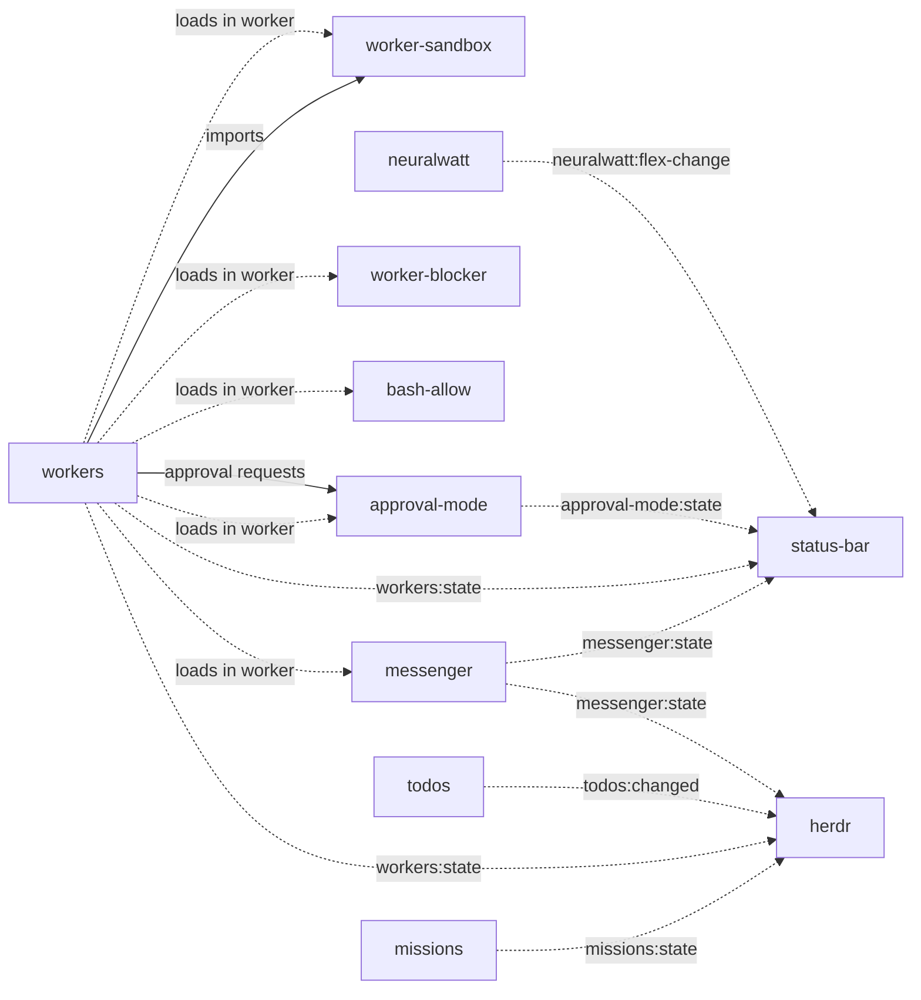

# Extension dependencies

Most extensions in this repository work alone. A few need another extension to work, and some only add features when a partner extension is loaded. This document lists each link, what breaks without the partner, and where the contract lives in the code.

The map covers four kinds of links:

1. **Code imports.** One extension imports a file from another extension's directory.
2. **Worker sessions.** The workers extension loads other extensions into each worker process.
3. **Event contracts.** One extension emits a `pi.events` event and another listens for it.
4. **Shared configuration.** Several extensions read the same config file through a `lib/` module.

Shared `lib/` helpers that hold no state (UI frames, file locks, path helpers) are not dependencies. Any extension can use them alone.

## Summary

| Extension | Needs | Without it |
|-----------|-------|------------|
| `workers` | `worker-sandbox` files on disk | `workers` does not load. It imports `worker-sandbox/src/client.ts`. |
| `workers` | `messenger`, `worker-blocker`, `bash-allow`, `approval-mode`, `worker-sandbox` in the worker process | Always loaded into workers. They cannot be removed. |
| `workers` | `approval-mode` in the parent session | Worker commands that need review are blocked. |
| `workers` | Optional: `bash-allow` in the parent session | The launcher uses `PI_BASH_ALLOW` instead of a parent flag snapshot. |
| `workers` | A worker model (`lib/worker-model.ts` config) | `spawn_worker` fails with a configuration error. `worker-model` is only the picker. |
| `handoff`, `btw`, `session-name`, `session-recap` | A small model (`lib/small-model.ts` config) | Each feature that calls the small model fails or skips. `small-model` is only the picker. |
| `approval-mode` | A Jev classifier model in the model registry | Commands that need review are blocked. |
| `status-bar` | Optional: `messenger`, `workers`, `approval-mode`, `neuralwatt` | The matching badge or footer segment stays empty. |
| `herdr` | Optional: `missions`, `workers`, `todos`, `messenger` | The matching pane token stays empty. |
| `ask-user`, `approval-mode` | Optional: the official Herdr Pi integration (outside this repository) | Herdr does not show blocked dialogs. |



Solid arrows are hard requirements. Dotted arrows are optional: the receiver works without the sender.

## 1. Code imports

`extensions/workers/src/provision/hook.ts` imports `startWorkerSandbox` from `extensions/worker-sandbox/src/client.ts`. The worktree setup hook runs inside the same sandbox as worker tools.

This is the only import that crosses from one extension directory into another. The `worker-sandbox` directory must exist next to `workers`. The `worker-sandbox` extension does not have to be loaded in the parent session. It registers nothing outside a worker (`PI_WORKER=1`).

## 2. Worker sessions

Each worker runs as a separate `pi` process with `--no-extensions` and an explicit list of `-e` paths. `extensions/workers/src/worker-extensions.ts` builds that list.

| Set | Extensions | Rule |
|-----|------------|------|
| Required | `messenger`, `worker-blocker`, `bash-allow`, `approval-mode`, `worker-sandbox` | Always added. `bash-allow` precedes `approval-mode`; `worker-sandbox` loads last so its built-in tool overrides win. |
| Default | `messenger`, `code-search`, `context7`, `web-search`, `synthetic`, `neuralwatt`, `approval-mode`, `worker-sandbox` | Used when the call, `PI_WORKER_EXTENSIONS`, and the config file give no list. |
| Forbidden | `workers`, `missions`, `autoresearch` | Rejected even when requested. |

The required extensions each carry one part of the parent-worker protocol:

- `messenger` gives the worker a mesh identity through `PI_MESSENGER_NAME`. The parent and the worker exchange mail through it.
- `worker-blocker` adds the `report_blocker` tool. It writes a marker to the spool file in `PI_WORKER_STREAM`. The parent `workers` runner reads the marker. Both sides share the format in `lib/worker-blocker.ts`.
- `bash-allow` enforces the parent's effective static command list. The launcher requests it through `bash-allow:request` and passes `--bash-allow=<list>` at startup. Without a parent listener, the launcher uses `PI_BASH_ALLOW`. Missing extension files prevent startup. Empty and malformed lists remain blocking.
- `approval-mode` gates `bash`, `background`, and `monitor` commands in the worker. It asks the parent over file descriptor 3 (`PI_WORKER_APPROVAL_FD`). It also enforces read-only workers.
- `worker-sandbox` replaces the built-in tools with sandboxed versions. It fails closed when the project has no `.pi/sandbox.json`.

### Parent approval

The parent side of the approval channel is `approval-mode`. The `workers` runner forwards each worker request as an `approval-mode:worker-request` event (`lib/worker-approval.ts`). `approval-mode` in the parent session listens for it and shows the dialog.

If the parent session does not load `approval-mode`, no listener answers. The request times out: 5 seconds for the mode check, 5 minutes for an approval. The worker then blocks the command. Commands that the classifier marks as known-safe still run.

### Model configuration

`spawn_worker` reads the worker model through `lib/worker-model.ts`. The source is `PI_WORKER_MODEL` or `worker-model.json`. The `worker-model` extension only gives the `/worker-model` picker. You can configure the model without it.

If the worker model or the small model points at a `synthetic` or `neuralwatt` model, that provider extension must be loaded. It registers the provider.

## 3. Event contracts

Most receivers copy the event name as a string literal instead of importing from the sender.
Shared contracts such as `bash-allow:request` use a `lib/` module so both extensions still load independently.
When you rename an event, change both sides.

| Event | Sender | Receivers |
|-------|--------|-----------|
| `messenger:state` | `messenger` | `status-bar` (unread mail), `herdr` (pane token) |
| `workers:state` | `workers` | `status-bar` (worker spend), `herdr` (combined cost) |
| `approval-mode:state` | `approval-mode` | `status-bar` (review-off badge) |
| `neuralwatt:flex-change` | `neuralwatt` | `status-bar` (flex badge) |
| `missions:state` | `missions` | `herdr` (pane token) |
| `todos:changed` | `lib/todos.ts` (used by `todos`) | `todos` (widget refresh), `herdr` (pane token) |
| `bash-allow:request` | `workers` (`lib/bash-allow.ts` contract) | `bash-allow` returns its effective list through a synchronous reply callback |
| `approval-mode:worker-request` | `workers` (`lib/worker-approval.ts`) | `approval-mode` (parent session) |
| `approval-mode:command-review` | `missions` (`lib/command-review.ts`) | `approval-mode`. Without a listener, the helper refuses hard denies and approves other commands. |
| `worker-sandbox:exec-request` | `missions` (`lib/sandbox-exec.ts`) | `worker-sandbox` while a sandbox is active. Without a listener, the caller runs the command on the host. |
| `herdr:blocked` | `ask-user`, `approval-mode` | Official Herdr Pi integration, outside this repository. See [herdr-integration.md](herdr-integration.md#blocked-dialogs-complete). |
| `autoresearch:state` | `autoresearch` | None in this repository |
| `recap:changed` | `session-recap` | None in this repository |

Event names are defined in these files:

- `extensions/status-bar/src/constants.ts` mirrors the names that `status-bar` reads.
- `extensions/herdr/src/metadata.ts` lists the names that `herdr` reads in `METADATA_EVENTS`.

### Status keys

`status-bar` also hides some `setStatus` keys from its footer, because their owners already show the same state in a widget. The keys are `small-model`, `missions`, `messenger`, `approval-mode`, `autoresearch`, `workers`, and `background-jobs`. `extensions/status-bar/src/footer.ts` has the list. Without `status-bar`, Pi shows these keys in its default footer.

## 4. Shared configuration

Some `lib/` modules own a config file or a store that more than one extension reads.

| Module | Owner of the picker or tool | Readers |
|--------|-----------------------------|---------|
| `lib/small-model.ts` | `small-model` (`/smallmodel`) | `btw`, `handoff`, `session-name`, `session-recap`, `status-bar` |
| `lib/worker-model.ts` | `worker-model` (`/worker-model`) | `workers`, `status-bar` |
| `lib/todos.ts` | `todos` (`todo` tool) | `todos` only |

None of the readers need the picker extension. They read the environment variable or the JSON file directly. `status-bar` watches both files and shows the current choice in the editor title.

`web-search` uses Synthetic credentials for its default provider. It reads `SYNTHETIC_API_KEY` or `auth.json` itself, so it does not need the `synthetic` extension.

## Keep this map current

Update this document when you:

- Import a file from another extension's directory.
- Add, rename, or remove a `pi.events` event that another extension reads.
- Change the required, default, or forbidden worker extension sets.
- Add a `lib/` module that holds state for more than one extension.

Find cross-extension imports with this command:

```bash
grep -rnE "from \"(\.\./)+[a-z-]+/src/" extensions --include=*.ts | grep -v "/lib/"
```
